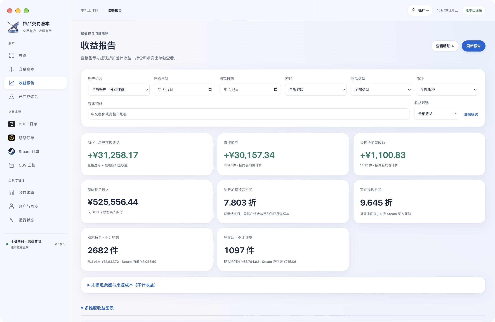
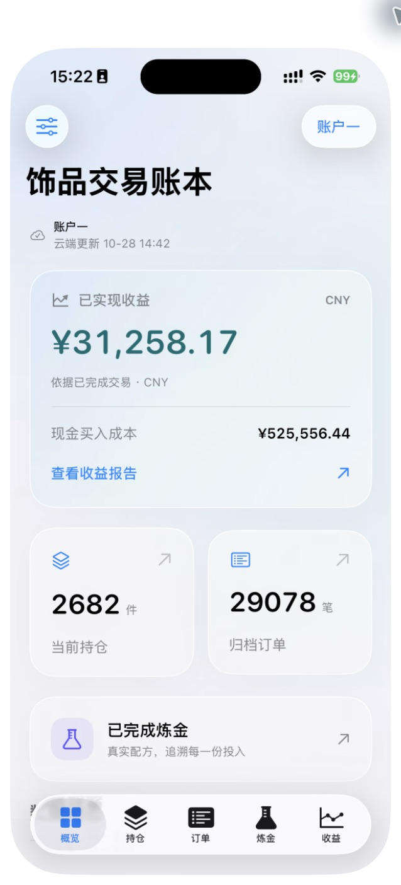
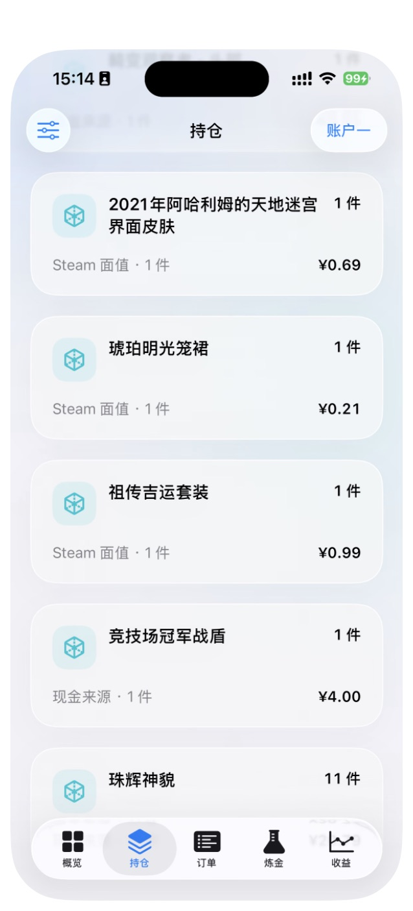
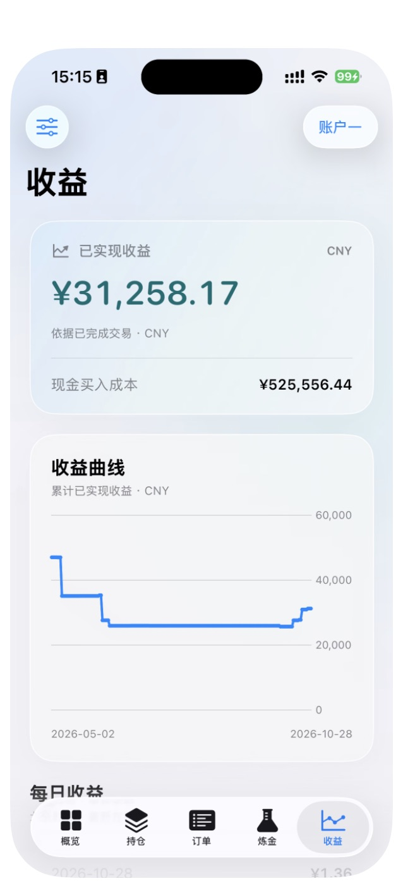
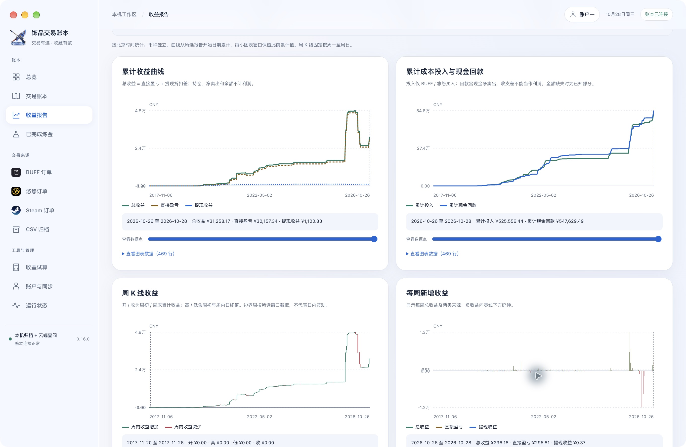
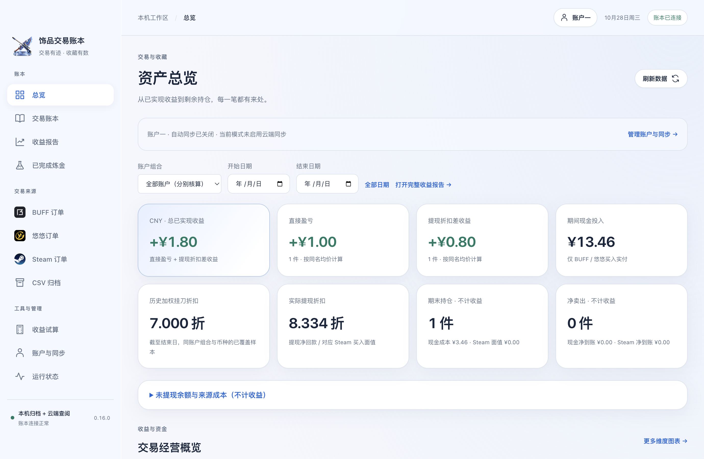

# game-asset-settle · 饰品交易账本

面向 BUFF、悠悠有品、Steam 玩家的个人交易账本：在 **macOS** 登录自己的平台账户，归档买卖记录、分析持仓与已实现收益，在 **iOS** 查阅自己部署的云端快照。

本项目用于学习交流，方便广大饰品玩家理解自己的交易记录。源码开放、数据可自托管、平台会话保留在本机；桌面端只读采集，不执行购买、卖出、发货或交易确认。项目与网易 BUFF、悠悠有品、Valve / Steam 无隶属或官方合作关系。

[下载 macOS / iOS](https://github.com/su4g/game-asset-settle/releases/tag/v0.16.0) · [项目官网](https://www.suag.top/) · [安装 macOS](docs/installation-macos.md) · [登录与使用](docs/login-and-use.md) · [部署云服务](cloud/README.md) · [安装 iOS](ios/README.md) · [安全说明](SECURITY.md)



*新版 Mac 实际运行截图，金额经作者授权公开。平台身份、登录凭据、服务器信息未展示；更多画面见下方及[项目官网](https://www.suag.top/)。*

## 下载与使用路线

| 你想做什么 | 从这里开始 |
| --- | --- |
| 只在 Mac 查看三平台记录 | [macOS 安装包](https://github.com/su4g/game-asset-settle/releases/download/v0.16.0/game-asset-settle-macos-0.16.0-arm64.zip) + [本机初始化](#先在-mac-运行) |
| 在 iPhone 随时查账 | 先配置 Mac，再[自建云服务](#部署自己的云服务)，最后[安装 iOS](#安装-ios-与-apple-账号) |
| 自己修改 / 学习实现 | 克隆整个仓库；`desktop/`、`ios/`、`server/`、`cloud/` 均包含完整相关源码 |
| 校验下载文件 | [SHA256SUMS.txt](https://github.com/su4g/game-asset-settle/releases/download/v0.16.0/SHA256SUMS.txt) |

**发布包说明**：macOS 为 Apple Silicon（arm64）应用 ZIP，包含 `.app`，采用 ad-hoc 签名，尚未 Apple 公证；iOS 为 [1.2.0 unsigned IPA](https://github.com/su4g/game-asset-settle/releases/download/v0.16.0/game-asset-settle-ios-1.2.0-unsigned.ipa)，需通过自己的 Apple 账号签名后安装。下载包不附带你的数据库、云连接、平台登录或签名凭据。Intel Mac 可按源码在本机打包。

本仓库包含整个应用及配套服务，`website/` 只是独立的项目介绍网站。当前 macOS 仍需要本机 PostgreSQL 和一次初始化；下载 `.app` 不能替代数据库配置。

## 当前源码

| 部分 | 版本 / 作用 | 位置 |
| --- | --- | --- |
| macOS | 0.16.0，Electron 本机工作台 | `desktop/` |
| iOS | 1.2.0（构建 4），SwiftUI 只读查询 | `ios/` |
| 本机账本服务 | 回环 HTTP + PostgreSQL，保存订单归档 | `server/` |
| 可选云服务 | 接收账户快照，为手机提供统一核算结果 | `cloud/` |
| 项目官网 | 独立静态站点，GitHub Pages | `website/` |

这是从现有应用当前源码提取的独立开源版本，包含已完成炼金、两账户隔离、统一收益口径及新版界面。根目录少量共享 JS 与旧账本资源仍为桌面和本机服务的依赖；浏览器扩展入口、自动购买执行器、私人数据、历史部署配置和签名材料不包含在本次提取中。`buff` / `BuffReader` 等内部标识保留以兼容数据结构。

## 能做什么

- **三平台归档**：BUFF 支持 CS2 / Dota 2；悠悠当前支持 CS2 已完成订单；Steam 归档本人社区市场成交。首次同步读取至末页，后续可增量或完整复核。
- **持仓与收益**：按账户组合、游戏、币种与完整名称核算，区分现金来源和 Steam 余额来源，展示挂刀、提现、直接转卖与数据缺口。
- **已完成炼金**：读取本人的 Steam CS2 库存历史，复盘真实合成事件、投入成本及产出去向，不生成未来配方。炼金收益单独展示，不叠加到原交易收益报告。
- **CSV / 名称映射**：导入历史、学习完整中英文名称对应，保留源数据。来源不明或金额缺失显示待核对，不把未知当成零成本利润。
- **多端查看**：固定两个独立账户组，每台终端只采集所选组；关闭窗口可在菜单栏后台同步，手机只查询最后上传的快照。

利润计算说明见[架构与核算](docs/architecture.md)。本人历史成交均价不是实时市场行情，持仓估值和试算结果也不是已实现收益。

## 软件运行截图

上方为 macOS 实机收益报告；下方为真实 iPhone 界面及 Mac 收益趋势。金额保留原样，账户仅显示通用组名。图片来自已发布的[官网截图](website/README.md#软件截图)，来源与哈希见[素材清单](website/asset-sources.json)。

| iPhone 总览 | iPhone 持仓 | iPhone 收益 |
| --- | --- | --- |
|  |  |  |

<details>
<summary>查看 macOS 实机收益趋势</summary>



</details>

<details>
<summary>更多功能界面：总览 / 账户与同步 / 已完成炼金（隔离验收数据）</summary>

以下来自应用的隔离验收，使用合成账号与订单，用于展示功能布局。




验收截图及 Mac Catalyst 预览的来源说明见[截图说明](docs/screenshots/README.md)。官网部署和维护见 [website/README.md](website/README.md)。

</details>

## 先在 Mac 运行

需要 macOS 13+、Node.js **22.12+（推荐 24 LTS）**、PostgreSQL。安装工具与常见问题见[完整教程](docs/installation-macos.md)。

如果尚未安装运行环境，可使用 Homebrew；已有 PostgreSQL 时复用自己的实例，避免争用端口：

```bash
brew install node@24 postgresql@17
export PATH="$(brew --prefix node@24)/bin:$(brew --prefix postgresql@17)/bin:$PATH"
brew services start postgresql@17
```

克隆和初始化：

```bash
git clone https://github.com/su4g/game-asset-settle.git
cd game-asset-settle
npm ci
npm run setup
npm run desktop
```

`setup` 连接本机 PostgreSQL，创建独立的 `game_asset_settle` 数据库及应用角色，将随机配对凭据写入被 Git 忽略的 `.ledger/config.json`，不需要 Chrome 扩展。已有数据库且配置缺失时会拒绝覆盖。

使用下载的 macOS 包时，解压后将 `.app` 放到你选择的应用目录；先完成以上 `setup`，再在 App“运行状态 → 选择现有账本配置”选择克隆目录中的 `.ledger/config.json`。开发模式 `npm run desktop` 会尝试自动读取此配置。不要把别人的配置直接拿来用。

安装包尚未公证。如果 macOS 提示开发者无法验证，先确认下载来源和校验值，再按 [Apple 官方说明](https://support.apple.com/en-us/102445)在“系统设置 → 隐私与安全”中为这一应用选择“仍要打开”（若系统提供该选项）；不要全局关闭系统安全保护。更完整的权限、后台、更新和备份说明见 [macOS 教程](docs/installation-macos.md)。

只使用 Mac 无需云端，完成初始化后按下方步骤登录平台。开发者也可以自行打包本机应用：

```bash
npm run desktop:package
```

默认会安装 `/Applications/饰品交易账本.app` 固定入口并正常重开新版。仅构建、不安装或启动可用 `npm run desktop:package -- --no-install`。发布包和源码构建均采用临时签名，未经过 Apple 公证。打包版只包含程序资源，仍需选择你自己的本机配置。

## Mac 端三平台登录认证

1. **选择账户组**：进入“账户与同步”，选择本机所属的账户一或账户二，点击“切换关联账户”。每组绑定自己的三个平台账号，不能把同一平台账号放到两组。
2. **打开官方登录窗口**：进入左侧对应平台订单页，点击“登录 / 切换账号”，在 App 打开的官方网页完成登录、扫码 / 验证码或平台要求的认证。
3. **返回 App 检查身份**：点击“检查登录”。程序会先关闭网页登录窗口，再核对实际账号并绑定当前组，防止同步途中换号。
4. **首次同步**：选择游戏、买卖方向和读取范围后同步；首次读到平台末页，记录多时可能需要较长时间。失败或手动停止会保留已保存的历史。

| 平台 | 登录入口 | 同步范围与注意事项 |
| --- | --- | --- |
| BUFF | App 内 `buff.163.com` 官方窗口 | CS2 / Dota 2 买卖历史；检查账号后开始读取 |
| 悠悠有品 | App 内 `www.youpin898.com` 官方窗口 | 当前为 CS2 已完成买卖；卖出需要当前账号的完成样本 / 详情核对通过 |
| Steam | App 内 `steamcommunity.com` 官方窗口 | 完成 Steam Guard 与市场资格检查；读取本人市场成交，另可同步 CS2 库存历史 |

**不需要把 Cookie、Token、Steam API Key、Apple 密钥或账号密码粘贴到代码中。** Safari / Chrome 登录态不自动共享给 App。平台会话只留在当前 Mac，云端不接收这些凭据。

Steam 查询间隔约 7～9 秒；遇到 429 / 503 等待冷却，不连续点击重试。没有悠悠已完成卖出样本时可能暂不开放卖出同步，不需要为验证而创建交易。具体步骤与错误处理见[登录与使用](docs/login-and-use.md)。

## 日常使用

| 页面 | 用途 |
| --- | --- |
| 总览 | 查看已实现收益、现金投入、持仓、数据完整性 |
| 交易账本 | 分析来源成本、挂刀、提现、直接转卖和持仓 |
| 收益报告 | 按期间 / 币种核对收益；在有依据的情况下补录缺失价格，可撤回 |
| 已完成炼金 | 从真实合成事件查看投入、产出、成本来源与出售结果 |
| 三平台订单 / CSV 归档 | 查询原始成交、完整复核、导入历史与名称映射 |
| 账户与同步 | 管理本机账户、登录状态、自动同步和云端连接 |

“启动及每 6 小时自动同步”在 App 运行时生效。关闭主窗口后可留在菜单栏运行；退出 App 或电脑休眠会停止采集，唤醒补一次到期任务。登录过期会通知并暂停，需要你主动重新认证。手机下拉刷新只查询云端最后一次成功上传的快照。

**核算原则**：金额按整数分计算；现金成本只计 BUFF / 悠悠买入；挂刀与提现按同组合同币种的实际样本折扣核算。持仓、净卖出、未提现余额不直接计报告利润；缺少价格或来源时显示未知 / 可计算部分。炼金收益独立展示，不与原交易报告相加。详见[架构与核算口径](docs/architecture.md)。

## 部署自己的云服务

架构是 **Mac 本机归档 → 自建 HTTPS 快照服务 → iOS 只读查询**。服务器不需要登录你的交易平台；只在 Mac 使用可跳过这一节。

1. 准备自己的 Linux 服务器、域名、HTTPS 证书、Node.js 24、Docker 与 Nginx。
2. 在 Mac 的仓库外生成私有连接文件，将下面示例域名换成你的域名：

```bash
mkdir -p "$HOME/.config"
npm run cloud:configure -- \
  --base-url https://ledger.example.com/buff-helper-api \
  --output "$HOME/.config/game-asset-settle"
npm run cloud:package
```

3. 使用上一步代码包或 [Release 云服务包](https://github.com/su4g/game-asset-settle/releases/download/v0.16.0/game-asset-settle-cloud-0.16.0.tar.gz)，按[服务器完整部署步骤](cloud/README.md)安装代码包和专用数据库，配置 systemd，通过自己的 HTTPS `/buff-helper-api/` 路径代理。数据库和应用 HTTP 端口仅监听回环；先备份 Nginx 配置、检查通过后 reload。
4. Mac 导入对应账户的 `.buffdesktop`，点击“立即上传云端”。每组使用独立写入码，首台成功上传终端绑定该组归属。
5. 在 Mac“导出手机连接文件”，将只读 `.buffconnection` 通过可信方式传给 iPhone。手机读取码可以查询这台部署的两个账户组。

`ledger.example.com` 是示例域名，项目不提供公共账本服务器。真实地址、读取码、写入码和数据库密码由你自行生成，不进入源码、安装包或网页。不要共享整个配置目录，不要通过删除待传批次 / 设备身份来解决同步冲突。

## 安装 iOS 与 Apple 账号

要求 **iOS 17+**。在 [Release](https://github.com/su4g/game-asset-settle/releases/tag/v0.16.0) 下载 unsigned IPA，或按 [iOS 源码构建说明](ios/README.md)生成自己的包。

| 方式 | 需要什么 | 安装与更新 |
| --- | --- | --- |
| Sideloadly 安装 IPA | 自己的 Apple 账号、电脑、iPhone、[官方 Sideloadly](https://sideloadly.io/) | 选择 IPA 和设备，完成个人签名；可启用此 App 的自动刷新 |
| Xcode 从源码运行 | Mac、Xcode 26+、自己的 Apple 账号 / Personal Team | 打开 `ios/BuffReader.xcodeproj`，选择 Team 与唯一 Bundle ID，连接真机 Run |
| Apple Developer Program | 付费开发者会员及适用的分发配置 | 适用于需要正式开发与分发能力的开发者；本项目当前不提供 App Store / TestFlight 安装通道 |

**不必为了个人真机测试先购买付费会员。** Apple 的免费 Personal Team 支持个人设备测试，但配置描述文件通常 7 天到期，届时需要重新签名 / 安装；设备和 App 数量也有限制。付费会员价格与权益以 [Apple 官方](https://developer.apple.com/help/account/basics/about-your-developer-account)及[加入计划说明](https://developer.apple.com/programs/enroll/)为准。

首次连接电脑时信任设备，并按系统要求[开启开发者模式](https://developer.apple.com/documentation/xcode/enabling-developer-mode-on-a-device)。Sideloadly 操作与续签限制见[官方 FAQ](https://sideloadly.io/faq)。更新时沿用相同 Apple 签名身份 / Bundle ID，保留其他 App 的续签任务。

安装后，打开左上角设置导入 `.buffconnection`；连接验证后读取码保存到 Keychain。iOS 不需要输入三平台账号密码，也不在手机采集平台订单。未签名 IPA 不能通过普通点按直接安装，本项目不会分发作者的 Apple 证书、私钥或设备授权描述文件。

## 常见问题

- **为什么刚安装没有数据？** 先完成本机 PostgreSQL 初始化、选择 `.ledger/config.json`，关联账户组，再登录并同步对应平台。
- **为什么电脑浏览器登录了，App 仍未登录？** App 使用独立会话，需在 App 的官方登录窗口认证并“检查登录”。
- **手机不更新怎么办？** 检查 Mac 是否运行、平台同步是否完成、云端上传是否成功，再检查手机连接；手机刷新不会唤醒关闭的 Mac。
- **收益为空或“待补全”？** 表示金额、历史覆盖或来源不足，不是零成本盈利。查看报告缺口与核算说明。
- **是否会自动购买 / 出售 / 发货？** 当前应用只归档、核算和查询，不执行这些交易操作。
- **是否能只用 Mac？** 可以，云端和 iOS 均为可选部分。

## 开发与验证

```bash
npm test                       # 离线逻辑和模拟接口测试
npm run test:pg                 # 本机 PostgreSQL 隔离数据库测试
npm run cloud:test:pg           # 云端隔离数据库测试
swift test --package-path ios
npm run desktop:verify -- --development
npm run audit:public           # 待公开文件的敏感路径与凭据模式检查
```

数据库测试只创建 `buff_goods_test_` 前缀临时库；桌面 smoke 使用独立偏好目录，禁止访问真实平台。需要的开发权限、校验范围见 [CONTRIBUTING](CONTRIBUTING.md) 与[发布检查记录](docs/public-release-audit.md)。模拟测试通过不代表平台实站接口永远可用。

## 开源理念、协议与权益

希望让玩家能查看核算逻辑、在自己的设备上保管账户、部署自己的服务，并通过可复现测试共同改进工具。接口调研参考了 [Steamauto](https://github.com/Steamauto/Steamauto) 的 BUFF / 悠悠相关接口描述；独立适配器中的来源注释予以保留，详见[第三方说明](THIRD_PARTY_NOTICES.md)。

原创程序代码与文档使用 [MIT License](LICENSE)，允许在保留版权与许可声明的前提下使用、修改和分发；“学习交流”是项目目的，不额外限制 MIT 赋予的权利。依赖遵循各自许可证；平台商标、游戏名称、饰品形象和相关素材不因本项目开源而转让权利。

程序按现状提供，不承诺数据完整性、平台持续兼容或收益，不构成投资建议。请仅处理本人或已获授权的账户，并遵守所在平台的使用规则。

**如果本项目内容侵犯了您的合法权益，请通过 [GitHub Issues](https://github.com/su4g/game-asset-settle/issues) 或邮箱 [suag725@163.com](mailto:suag725@163.com) 联系作者，提供相关内容与权属说明；核实后会及时删除或调整。** 联系时请勿公开账号密码、令牌、连接文件或其他人的个人数据。
