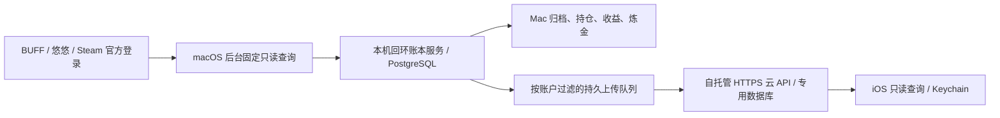

# 架构与核算口径

平台会话留在 Mac 独立分区；云端只存本组订单快照和核算设置。`desktop/account-profiles.cjs` 固定两个组，`account-runtime.cjs` 校验真实身份，`account-data.cjs` 在核算 / 上传前过滤。切换账户、连接或币种后旧异步响应不得进入新视图。

## 代码组织

| 位置 | 责任 |
| --- | --- |
| `desktop/main.cjs` / `preload.cjs` / `runtime.cjs` | Electron 进程、受限桥接、打包资源和回环请求 |
| `desktop/*-session.cjs` / `*-orders.cjs` | 三平台独立会话、固定查询、限流与原子归档 |
| `desktop/sync-scheduler.cjs` / `startup-sync.cjs` | 启动检查、每 6 小时同步、停止 / 休眠 / 取消 |
| `desktop/order-ledger.cjs` / `profit-report.cjs` | 来源成本池与共用报告口径 |
| `desktop/alchemy.cjs` / `steam-inventory*.cjs` | 库存历史与真实合成复盘 |
| `desktop/cloud-sync.cjs` | 持久设备身份、批次、序号、回执、断网原批重试 |
| `server/history-store.cjs` | 原始历史、CSV 和名称映射；不创建已确认手工交易 |
| `cloud/` | 专用快照存储、校验、共用计算结果和查询分页 |
| `ios/Sources/BuffReaderCore` / `ios/App` | API 模型、Keychain、隔离刷新、SwiftUI |
| `common.js` 与根目录少量账本文件 | 共用金额工具及现有服务兼容资源 |

本次提取保留了服务的完整依赖，不分发 Chrome 扩展 manifest、内容脚本或自动购买执行器。根目录旧账本文件不代表新版重新开放逐件核对或平台交易。

## 统一收益

按账户组合、游戏、币种与完整名称建立平均成本池，不用物品 ID、FIFO 或 7 天交易冷却强行配对。现金买入来源来自 BUFF / 悠悠，Steam 买入使用余额来源成本。

- Steam 卖出优先消耗现金来源，形成挂刀样本。挂刀折扣 = 现金买入成本 ÷ Steam 净到账。
- BUFF / 悠悠卖出优先消耗 Steam 来源，计提现；剩余现金来源计直接转卖。
- `profit-report.cjs` 统一总览、账本和收益报告：直接盈亏以对应现金买入成本计算；提现收益 = 对应 Steam 买入面值 ×（实际提现折扣 − 同组合同币种已覆盖挂刀的加权折扣）。
- 无挂刀样本不借固定折扣，缺金额 / 来源不按零计利润。持仓、净卖出及未提现余额不算报告利润，Steam 买入不重复增加现金投入。
- 时间范围带入期初持仓与余额来源成本，历史加权样本截至报告结束日。独立“历史成本估算”不改真实报告或档案，估算值必须标明。

整数分累计分摊，展示时才取整。Steam 手续费使用 `common.js` 中的最低费与分位规则，不使用粗略的 `gross * 0.85`。本人历史成交均价与市场行情不同。

## 已完成炼金

读取 CS2 `Crafted` 事件，只处理真实 10 / 5 件投入和 1 件产出，支持连续合成；材料沿同组、币种和完整名称的平均购买成本结转。旧材料未覆盖、缺价、同分钟顺序不明、同名产出去向不明都保持未知。官方资产 ID 只辅助确认产出去向，不用于逐件买入成本匹配。

炼金现金收益与纯 Steam 余额盈亏分别显示，并且独立于原交易收益报告。原订单持仓尚未扣除合成消耗，不能直接与炼金结果相加。

## 同步完整性

首轮读至末页；增量只在该范围曾完整覆盖且连续两页不变时允许边界停止，同时复查进行中 / 未知状态。Steam 429 / 503 冷却持久保存，失败不自动重放平台操作。

云端每批恰好一个账户，首台成功上传终端绑定写入归属；同设备同序号同内容幂等。原历史不能被后续快照无声丢弃，跨账号、旧序号、同序号不同内容和设备变化均拒绝。连接变更不能把未确认批次送往另一台服务器。
