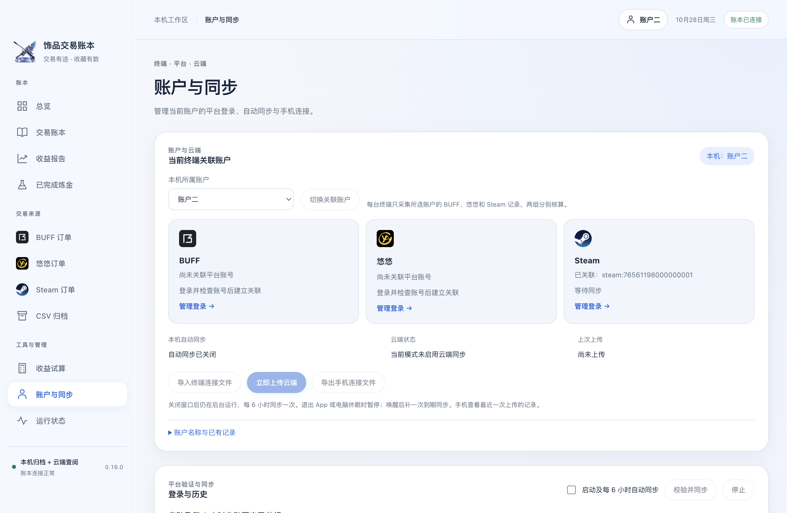
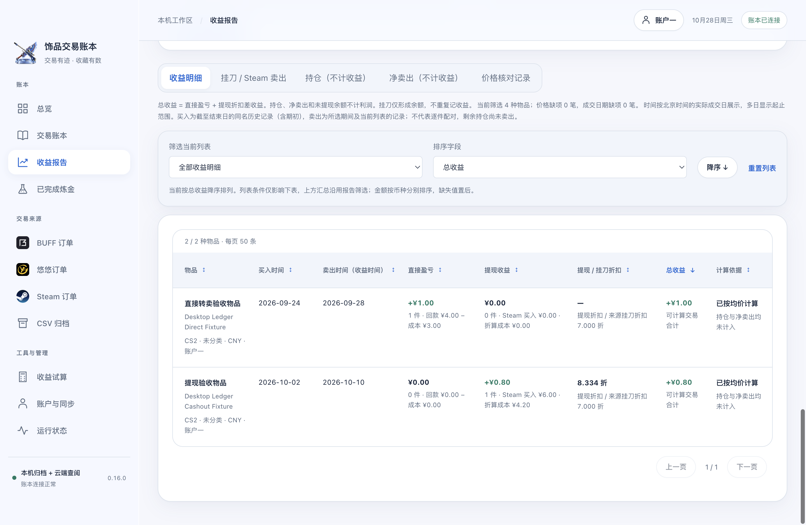
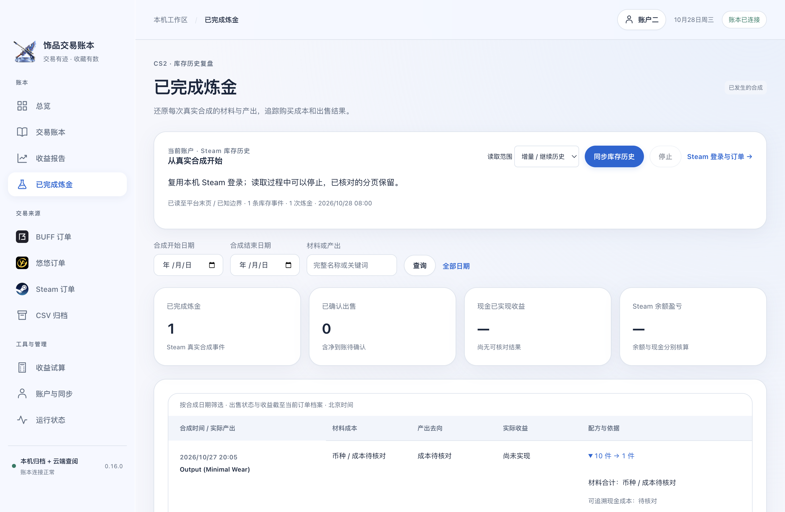

# 三平台登录认证与使用

先完成 [macOS 安装](installation-macos.md)。登录的是自己在各平台的官方网页账户；程序没有共享账号，也不要求购买 API Key。原始会话保存在当前电脑的独立 Electron 分区，手机不登录这三个平台。

## 选择账户组

进入“账户与同步”，在“本机所属账户”选择账户一或账户二，点击“切换关联账户”。每组分别绑定一个 BUFF、悠悠、Steam 账号，两组独立核算；同一个平台账号不能绑定两组。已有归档需要在“账户名称与已有记录”中明确关联，程序不会按昵称、物品同名或 CSV 标签猜测归属。

*实际 App 的隔离验收画面；显示的 Steam ID 是合成测试身份。*

## BUFF

1. 左侧“BUFF 订单”，点击“登录 / 切换账号”。
2. 在 App 打开的 `buff.163.com` 官方窗口内按页面提供的方式登录，并完成平台要求的验证；密码、验证码或扫码确认仅在官方界面处理。
3. 返回主工作台，点击“检查登录”。程序先销毁登录窗口，再核对真实账号并关联到当前账户组。
4. 选择 CS2 / Dota 2、买入 / 卖出和历史范围，开始同步。首次读取到平台末页；历史很多时耐心等待，可以手动停止，已有归档保留。

查看 Chrome 中已经登录的 BUFF 页面不能代替本 App 登录。切换平台账号前先停止同步，重新登录后再次检查；已绑定组出现不同账号会停止，避免混账。

## 悠悠有品

1. 左侧“悠悠订单”，点击“登录 / 切换账号”，使用 `www.youpin898.com` 官方窗口完成登录。
2. 返回 App 点击“检查登录”。后台仅在本机使用官方会话和设备请求头，不把它们输出到工作台或上传云端。
3. 选择买入或卖出后同步。当前支持 **CS2 已完成订单**，同一订单内多个商品分别保留。
4. 卖出同步需要当前账号的已完成样本 / 详情核对成功。没有完成卖出样本时可能无法开放卖出同步；空列表不等于验证成功，不要为此创建测试交易。

App 不要求手工提取 `uu_token`。纯租赁不混入持仓；过户购买只有在详情明确证明实际付款时计入。平台返回未知结构、金额单位冲突或方向不明时会停止并保留原历史。

## Steam

1. 左侧“Steam 订单”，点击“登录 / 切换账号”，在 `steamcommunity.com` 官方窗口完成账户登录及 Steam Guard 要求。
2. 返回 App 点击“检查登录”。程序关闭登录窗口并核对当前 Steam 账号和市场访问资格。
3. 同步本人社区市场买卖历史。请求间隔约 7～9 秒，大量历史可能耗时较长；不通过提高并发跳过限制。
4. 需要炼金复盘时，进入“已完成炼金”，点击“同步库存历史”。这读取当前绑定账号的 CS2 库存历史，和市场订单共用会话、取消与冷却机制。

不需要 Steam Web API Key、交易链接或手机令牌密钥；程序不接受 / 确认交易报价。未满足 Steam 市场资格、会话过期、429 / 503 会明确暂停，按平台提示处理后再操作。

## 看懂同步与报表

“账户与同步 → 校验并同步”可统一检查并增量更新已配置平台。同步前后都会校验账号；失败、中途换号、重复页不会清空已有历史。完整复核会重新读历史以补齐旧状态；增量边界不是完整末页。

- **总览 / 交易账本 / 收益报告** 共用已实现收益口径。现金投入只计 BUFF / 悠悠买入；Steam 买入不再重复算现金投入。
- **持仓、净卖出、未提现余额** 不直接计入报告利润。缺金额或成本来源会显示未知 / 可计算部分，不能按零成本理解。
- **价格核对** 只在收益报告中补足可验证的缺失记录，不改平台原档案，可撤回或恢复。后来出现对应平台记录会暂停补录，防止重复。
- **已完成炼金** 单独复盘真实合成。现金收益和纯 Steam 余额盈亏分开，不与交易报告相加；原交易持仓尚未扣除合成消耗。
- **CSV 归档** 先核对账户标签、币种和列映射。在线 Steam 历史与标准 CSV 完全匹配后会在查询视图抑制重复来源，原 CSV 不删除。

以上均为当前界面运行截图，金额与订单为隔离演示数据。

## 手机连接

部署自己的[云端](../cloud/README.md)后，Mac 在“账户与同步”导入对应账户的终端连接文件，点击“立即上传云端”。随后“导出手机连接文件”，通过可信方式传到 iPhone；在 [iOS App](../ios/README.md) 左上角设置中导入。

`.buffdesktop` 含写入码，只给对应终端；`.buffconnection` 只含读取码，但能读取该部署的两个账户组。文件不应发到 Issue、公开网盘或仓库。手机下拉刷新仅查询云端，不会驱动已关闭的 Mac 去采集平台。
